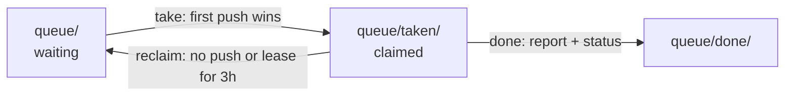

# take-once

[](https://github.com/justin-rhee/take-once/actions/workflows/test.yml) [](LICENSE)  

Lets several AI coding agents share one to-do list in git, without two of them ever grabbing the same task. It doesn't care which agent does the work: Claude Code, Codex, or anything you can start from a shell.

```
$ take-once pick
take  040-retry-config.md  ok
wait  041-add-retry.md     blocked:040
take  042-docs-pass.md     ok

$ take-once take 040-retry-config.md laptop
took 040-retry-config.md

$ take-once take 040-retry-config.md desktop    # the other machine, a second later
refuse 040-retry-config.md already-taken
```

That's real output. `bash examples/demo.sh` reproduces it in a throwaway folder.

I had two machines running coding agents off one shared task list, and it broke three ways in a day: finished work got rebuilt, a dead claim held up every task touching the same files for five hours, and tasks started on code that hadn't been merged yet. None of it raised an error.

## Use it if

- you run coding agents on more than one machine, or more than one at a time
- their tasks depend on each other's work being merged, not just finished
- you'd rather keep the list in git than run a service for it

## Install

Node 22 and git, nothing else. Inside a clone of your repo:

```sh
npx github:justin-rhee/take-once#v1.0.0 init    # creates a queue branch with one example task
npx github:justin-rhee/take-once#v1.0.0 pick
```

`init` never replaces an existing queue and doesn't touch your working tree. Prefer a single file? `curl -O https://raw.githubusercontent.com/justin-rhee/take-once/main/src/take-once.mjs` works the same. A [full example task](examples/042-add-retry.md) shows the format.

## How it works



1. `pick` reads the `queue` branch and says which tasks are ready, which are waiting, and why (`--json` for scripts)
2. `take` moves one task to `queue/taken/` in a commit pushed without force, so if two machines push at once, git keeps one and the other is told it lost
3. your agent works on its own branch, running `lease` now and then so the claim stays fresh
4. `done` moves the task to `queue/done/` with a report, and anything blocked on it waits until its branch is merged into main

Each task file starts with three header lines take-once reads:

```yaml
Blocked by: 040
Touches: src/net/, tests/net-retry.test.js
Branch: add-retry (from main)
```

Two tasks whose Touches overlap never run at the same time. How I write tasks and agent prompts around this: [docs/running-builders.md](docs/running-builders.md).

## Why not GitHub Issues or a queue service?

An issue can have several assignees, so nothing stops two agents claiming the same one, and nothing knows that a closed issue's code isn't merged yet. A queue service like Redis or SQS gets the claim right, but it's one more thing to run and keep alive, and its state lives outside the repo your agents already share. Keeping it in git costs speed: every take is a fetch, a commit and a push, under a second on a local remote.

## What it won't do

- stop someone who can push to the queue branch from moving files by hand or force-pushing, so protect the branch if that matters
- recognize a squash or rebase merge, which reads as not merged because the branch head never lands in main
- check what an agent changed against its Touches line; [touchset-gate](https://github.com/justin-rhee/touchset-gate) does that half
- correct for a machine whose clock is hours off, which can reclaim live work early
- tell a dead agent from one that works three hours without pushing or renewing its lease
- run your agent or merge anything

## How I tested it

- 12 tests against real git repos, in about seven seconds: `node tests/take-once.test.mjs`
- eight machines racing for three tasks at the same moment: exactly three takes succeed, one per task
- turning the push into a force push makes that test fail, so it's testing the lock and not luck

<details>
<summary>More on testing</summary>

A second race test stages the collision on purpose: one machine's whole take runs in the gap between the other's commit and its push. Skipping the re-check before each attempt also fails both race tests, plus a replay of the original incident, where finished and claimed tasks get fed back in and the branch must not move.

Building the race test caught a real bug: two takes on one machine could read the list while the other moved it, so every read now pins one commit. CI runs the suite on macOS and Ubuntu. Design reasoning: [docs/ADR.md](docs/ADR.md).

</details>

## Contributing

The most useful contribution right now is squash-merge detection, the biggest gap above. A pull request with a failing test that builds a squash-merged branch is the best way in.

## License

MIT. See [LICENSE](LICENSE). No warranty. Security notes and how to report a problem: [SECURITY.md](SECURITY.md).

<!-- related:start -->
## Related

- [touchset-gate](https://github.com/justin-rhee/touchset-gate): flags any file an agent changed outside its task
- [never-worse-backup](https://github.com/justin-rhee/never-worse-backup): keeps an auto-backup from saving another session's half-finished work

Part of a small set of tools I pulled out of my own agent harness. I use them myself and read every issue. More on my [GitHub profile](https://github.com/justin-rhee).
<!-- related:end -->
